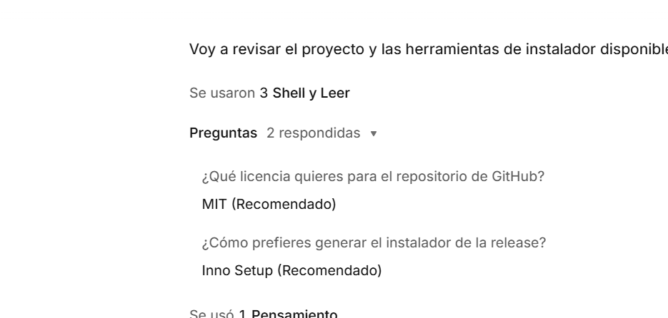

# RustTime

[](LICENSE)


Aplicación de escritorio para **Windows** escrita en Rust que permite programar el **apagado** o el **reinicio** del equipo, cancelar/deshabilitar esa programación y consultar información de **discos duros** y **batería**.



> Si el repositorio se aloja bajo otro usuario/nombre, ajusta los enlaces de descarga de esta sección.

## Descargas

Estos archivos se publican en la [página de releases](https://github.com/vecttrz/RustTime/releases):

| Artefacto | Archivo | Uso recomendado |
| --- | --- | --- |
| **Instalador** | `RustTime-v0.1.0-setup.exe` | Instalación en `{Program Files}\RustTime`, con acceso directo y desinstalador. |
| **Portable** | `RustTime-v0.1.0-portable.zip` | Ejecutar sin instalar, por ejemplo desde una memoria USB. |
| **Checksums** | `RustTime-v0.1.0-checksums.txt` | Verificación SHA-256 de los archivos anteriores. |

- [Descargar instalador](https://github.com/vecttrz/RustTime/releases/download/v0.1.0/RustTime-v0.1.0-setup.exe)
- [Descargar versión portable](https://github.com/vecttrz/RustTime/releases/download/v0.1.0/RustTime-v0.1.0-portable.zip)
- [Ver checksums](https://github.com/vecttrz/RustTime/releases/download/v0.1.0/RustTime-v0.1.0-checksums.txt)

Para verificar un archivo en PowerShell:

```powershell
Get-FileHash .\RustTime-v0.1.0-setup.exe -Algorithm SHA256
```

## Funciones

### Apagado / Reinicio

- Selección de **horas** y **minutos** (hasta 365 días).
- Elección entre **apagar el equipo** o **reiniciarlo**.
- Botón **Programar**: ejecuta `shutdown /s /t <segundos>` o `shutdown /r /t <segundos>`. La cuenta atrás de Windows sigue activa aunque se cierre RustTime.
- Casilla **Deshabilitar apagado automático**: al marcarla se ejecuta `shutdown /a` y se impiden nuevas programaciones mientras esté activa.
- Botón **Cancelar operación actual** para abortar la programación pendiente.
- Visualización del tiempo restante y del resultado de cada operación.

### Discos duros

- Muestra cada disco físico conectado con su tipo, capacidad y **horas totales de encendido** (S.M.A.R.T., `Power_On_Hours`).
- La lectura de horas S.M.A.R.T. requiere ejecutar la aplicación **como administrador**; si no está disponible se ofrece un botón para reiniciarla con permisos elevados.

### Batería

- **Ciclos consumidos** (informe XML de `powercfg /batteryreport`).
- **Carga actual** (%) y **salud** de la batería (capacidad actual frente a la de diseño).

### Interfaz

- Disposición **horizontal de dos columnas**: controles de apagado a la **izquierda** e información de discos y batería a la **derecha**.
- Toda la información aparece **centrada** dentro de su columna y agrupada en secciones, con **márgenes laterales** en el formulario.
- La ventana **no se puede maximizar ni redimensionar manualmente**.
- El **alto se ajusta automáticamente al contenido** (por ejemplo, crece si aparece la cuenta atrás o más discos).
- **Idioma automático:** si Windows está configurado en español la interfaz se muestra en español; con cualquier otro idioma se muestra en inglés.
- El icono de `design/Icon.ico` está incrustado en el ejecutable y se usa también como icono de la ventana.
- Los datos del sistema se actualizan al iniciar, al pulsar **Actualizar** y automáticamente cada 5 minutos.
- Créditos de desarrollo visibles en la parte inferior de la ventana.

## Instalación

### Instalador

1. Descarga `RustTime-v0.1.0-setup.exe`.
2. Ejecútalo y sigue el asistente.
3. Abre RustTime desde el menú Inicio o el acceso directo del escritorio.

El desinstalador se encuentra en la misma carpeta de instalación y en *Agregar o quitar programas*.

### Portable

1. Descarga `RustTime-v0.1.0-portable.zip`.
2. Extrae el archivo `RustTime.exe`.
3. Ejecútalo directamente; no necesita instalación ni escribir en el registro.

## Requisitos

- Windows 10 u 11.
- Para las horas S.M.A.R.T. de los discos, permisos de administrador (la propia aplicación ofrece relanzarse elevada).

## Compilación desde el código fuente

Necesitas [Rust](https://rustup.rs/) 1.100 o superior y, para generar el instalador, [Inno Setup 6](https://jrsoftware.org/isinfo.php).

```powershell
# Compilar la aplicación
cargo build --release

# Crear instalador y ZIP portable en la carpeta release\
powershell -ExecutionPolicy Bypass -File .\scripts\build-release.ps1
```

El ejecutable compilado se genera en `target\release\rusttime.exe` y los artefactos en `release\`.

## Uso rápido

1. Elige **horas** y **minutos**.
2. Selecciona **Apagar** o **Reiniciar**.
3. Pulsa **Programar**.
4. Si necesitas abortar, pulsa **Cancelar operación actual** o marca **Deshabilitar apagado automático**.

También puedes cancelar desde una terminal:

```powershell
shutdown /a
```

## Solución de problemas

- **«Horas no disponibles» en los discos:** Windows no expone los contadores S.M.A.R.T. sin elevación. Pulsa **Reiniciar como administrador** y acepta el aviso de UAC.
- **El apagado no se cancela:** comprueba que no haya otra programación activa y ejecuta `shutdown /a` como administrador.
- **Idioma incorrecto:** RustTime sigue el *idioma de interfaz de usuario* de Windows (`GetUserDefaultUILanguage`), no el formato regional.

## Estructura del repositorio

```text
design/       Iconos del proyecto (Icon.ico, Icon.png, Icon.af)
docs/         Capturas y documentación
installer/    Script de Inno Setup para el instalador
scripts/      Script para construir los artefactos de release
src/          Código fuente Rust (main.rs, sysinfo.rs, i18n.rs)
build.rs      Incrusta Icon.ico como recurso del ejecutable
release/      Artefactos generados (no versionados)
```

## Créditos

Desarrollo: **vecttrz** · 2026

## Licencia

Distribuido bajo la licencia [MIT](LICENSE).

> **Nota:** no ejecutes la aplicación con un tiempo muy corto si no quieres que el equipo se apague o reinicie.
