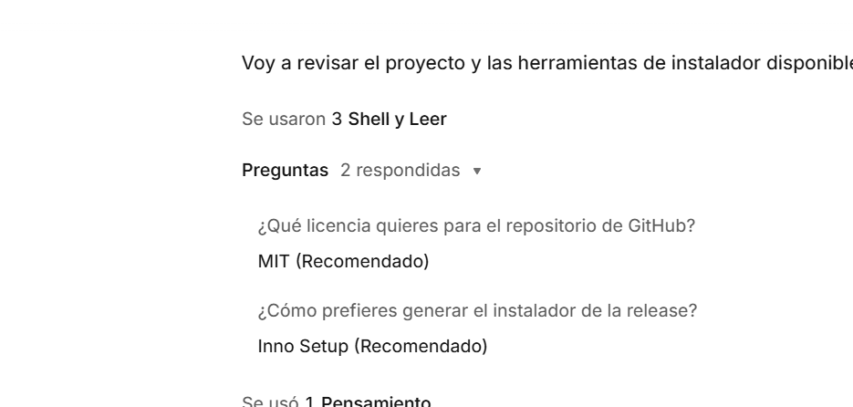

# RustTime — Product Description

**Version:** 0.1.0  
**Developer:** vecttrz  
**Year:** 2026  
**License:** MIT  
**Platform:** Windows 10 / 11

---

## 1. Executive summary

RustTime is a lightweight Windows desktop application that lets you **schedule a computer shutdown or restart** by hours and minutes, cancel that schedule, and inspect technical hardware information: **total power-on hours for each disk** and **battery status** (cycles, charge, and health).

The information is presented in a horizontal, centered window with automatic height. The interface language follows the system: Spanish when Windows is set to Spanish, English otherwise.



---

## 2. Purpose and target audience

RustTime is intended for:

- Users who need to leave a long task running and **automatically shut down or restart** when it finishes.
- Users who want to **quickly cancel** a pending shutdown schedule.
- Users who want to know their **disk wear** and **battery health** without installing additional tools.

It does not require an internet connection, does not send data, and only writes to the registry as needed when the installer is used.

---

## 3. Features

### 3.1 Shutdown and restart

| Feature | Description |
| --- | --- |
| Time selection | Hours (0–8,760, up to 365 days) and minutes (0–59). |
| Shut down | Runs `shutdown /s /t <seconds>`. |
| Restart | Runs `shutdown /r /t <seconds>`. |
| Schedule | Starts the Windows countdown; it keeps running even if RustTime is closed. |
| Cancel operation | Runs `shutdown /a`. |
| Disable automatic shutdown | Cancels any schedule and blocks new schedules while checked. |
| Status and countdown | Shows the result of each action and the remaining time. |

### 3.2 Disk information

- Lists every connected **physical disk**.
- Shows name, type (SSD/HDD), capacity, and **total power-on hours** (S.M.A.R.T., `Power_On_Hours`).
- If Windows does not expose that data without elevated permissions, a notice and a button to **restart as administrator** are shown.

> Reading S.M.A.R.T. data requires administrator privileges on most Windows computers.

### 3.3 Battery information

- **Consumed cycles** (obtained from the `powercfg /batteryreport` XML report).
- **Current charge** as a percentage.
- Battery **health**: current capacity versus design capacity, in mWh.

### 3.4 Interface and user experience

- **Two-column layout**: controls on the left, computer information on the right.
- Centered and grouped content with side margins.
- **Non-maximizable** and **non-resizable** window.
- **Dynamic height:** the window grows or shrinks according to the content.
- Custom icon embedded in the executable and the window.
- Automatic language: **Spanish** / **English**.
- Data refresh on startup, on demand (**Refresh**), and every 5 minutes.

---

## 4. Requirements

- Windows 10 or 11.
- Administrator permissions for S.M.A.R.T. hours (the application offers to restart elevated).
- To build from source: Rust 1.100+ and Inno Setup 6 (only for generating the installer).

---

## 5. Installation instructions

### 5.1 Installer (recommended)

1. Download **`RustTime-v0.1.0-setup.exe`** from the repository's *Releases* section.
2. Run the file. If Windows shows the User Account Control (UAC) prompt, click **Yes**.
3. Choose the wizard language and follow the instructions.
4. Select the destination folder (default: `C:\Program Files\RustTime`).
5. Optionally check **Create a desktop shortcut**.
6. Click **Install** and then **Finish**.

RustTime will be available in the Start menu and, if selected, on the desktop.

**Uninstallation:** open *Add or remove programs*, select RustTime, and click **Uninstall**. You can also run `unins000.exe` from the installation folder.

### 5.2 Portable version (no installation)

1. Download **`RustTime-v0.1.0-portable.zip`**.
2. Extract the contents to any folder (for example, a USB drive).
3. Run **`RustTime.exe`**.

It does not create shortcuts or registry entries. To "uninstall" it, simply delete the folder.

### 5.3 Building from source

```powershell
git clone https://github.com/vecttrz/RustTime.git
cd RustTime
cargo build --release
```

The executable will be at `target\release\rusttime.exe`.

To also generate the installer and the portable ZIP:

```powershell
powershell -ExecutionPolicy Bypass -File .\scripts\build-release.ps1
```

The artifacts are created in `release\`.

---

## 6. Basic usage

1. Open RustTime.
2. Set **hours** and **minutes**.
3. Select **Shut down the computer** or **Restart the computer**.
4. Click **Schedule**.
5. To abort, click **Cancel current operation** or check **Disable automatic shutdown**.

You can also cancel from a terminal:

```powershell
shutdown /a
```

---

## 7. Safety and best practices

- Double-check the time before scheduling a shutdown.
- Save your work before using short delays.
- Disk and battery data are obtained through Windows and PowerShell commands; RustTime does not send them to any server.
- If you grant administrator permissions, do so only from the application's own **Restart as administrator** button.

---

## 8. Troubleshooting

| Situation | Solution |
| --- | --- |
| "Hours unavailable" for disks | Click **Restart as administrator** and accept UAC. |
| The shutdown is not cancelled | Run `shutdown /a` as administrator. |
| The interface appears in the wrong language | RustTime follows the Windows UI language, not the regional format. |
| The installer does not open | Verify the file's SHA-256 hash against the one included in the release. |

---

## 9. Integrity verification

The release includes `RustTime-v0.1.0-checksums.txt` with SHA-256 hashes. To verify them:

```powershell
Get-FileHash .\RustTime-v0.1.0-setup.exe -Algorithm SHA256
Get-FileHash .\RustTime-v0.1.0-portable.zip -Algorithm SHA256
```

---

## 10. Credits and license

Development: **vecttrz** · 2026.

RustTime is distributed under the **MIT** license. See the `LICENSE` file included in the repository and in the installation.
