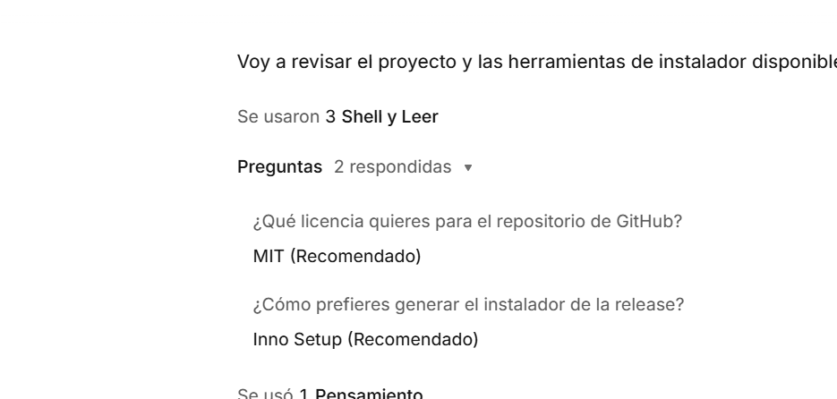

# RustTime — Documento descriptivo del producto

**Versión:** 0.1.0  
**Desarrollo:** vecttrz  
**Año:** 2026  
**Licencia:** MIT  
**Plataforma:** Windows 10 / 11

---

## 1. Resumen ejecutivo

RustTime es una aplicación de escritorio ligera para Windows que permite **programar el apagado o el reinicio del equipo** con un rango de horas y minutos, cancelar esa programación y consultar información técnica del hardware: **horas totales de encendido de cada disco** y **estado de la batería** (ciclos, carga y salud).

La información se presenta en una ventana horizontal, centrada y con altura automática. El idioma de la interfaz se adapta al sistema: español si Windows está configurado en español, inglés en cualquier otro caso.



---

## 2. Propósito y público objetivo

RustTime está pensado para:

- Usuarios que necesitan dejar una tarea larga en ejecución y **apagar o reiniciar automáticamente** al terminar.
- Usuarios que quieren **cancelar rápidamente** una programación de apagado.
- Usuarios que desean conocer el **desgaste de sus discos** y la **salud de la batería** sin instalar herramientas adicionales.

No requiere conexión a internet, no envía datos y no escribe en el registro más allá de lo necesario si se usa el instalador.

---

## 3. Funcionalidades

### 3.1 Apagado y reinicio

| Función | Descripción |
| --- | --- |
| Selección de tiempo | Horas (0–8.760, hasta 365 días) y minutos (0–59). |
| Apagar | Ejecuta `shutdown /s /t <segundos>`. |
| Reiniciar | Ejecuta `shutdown /r /t <segundos>`. |
| Programar | Inicia la cuenta atrás de Windows; sigue activa aunque se cierre RustTime. |
| Cancelar operación | Ejecuta `shutdown /a`. |
| Deshabilitar apagado automático | Cancela cualquier programación y bloquea nuevas programaciones mientras esté marcado. |
| Estado y cuenta atrás | Muestra el resultado de cada acción y el tiempo restante. |

### 3.2 Información de discos

- Lista cada **disco físico** conectado.
- Muestra nombre, tipo (SSD/HDD), capacidad y **horas totales de encendido** (S.M.A.R.T., `Power_On_Hours`).
- Si Windows no expone esos datos sin permisos elevados, aparece un aviso y un botón para **relaunch como administrador**.

> La lectura de S.M.A.R.T. requiere privilegios de administrador en la mayoría de equipos Windows.

### 3.3 Información de batería

- **Ciclos consumidos** (obtenidos del informe XML de `powercfg /batteryreport`).
- **Carga actual** en porcentaje.
- **Salud** de la batería: capacidad actual frente a capacidad de diseño, en mWh.

### 3.4 Interfaz y experiencia de usuario

- Disposición de **dos columnas**: controles a la izquierda, información del equipo a la derecha.
- Contenido centrado y agrupado, con márgenes laterales.
- Ventana **no maximizable** y **no redimensionable manualmente**.
- **Alto dinámico:** la ventana crece o se reduce según el contenido.
- Icono propio incrustado en el ejecutable y en la ventana.
- Idioma automático: **español** / **inglés**.
- Actualización de datos al iniciar, bajo demanda (**Actualizar**) y cada 5 minutos.

---

## 4. Requisitos

- Windows 10 u 11.
- Para las horas S.M.A.R.T., permisos de administrador (la aplicación ofrece relanzarse elevada).
- Para compilar desde el código fuente: Rust 1.100+ e Inno Setup 6 (solo para generar el instalador).

---

## 5. Instrucciones de instalación

### 5.1 Instalador (recomendado)

1. Descarga **`RustTime-v0.1.0-setup.exe`** desde la sección *Releases* del repositorio.
2. Ejecuta el archivo. Si Windows muestra el control de cuentas de usuario (UAC), pulsa **Sí**.
3. Elige el idioma del asistente y sigue las instrucciones.
4. Selecciona la carpeta de destino (por defecto, `C:\Program Files\RustTime`).
5. Opcionalmente marca **Crear un acceso directo en el escritorio**.
6. Pulsa **Instalar** y, al terminar, **Finalizar**.

RustTime quedará disponible en el menú Inicio y, si la seleccionaste, en el escritorio.

**Desinstalación:** abre *Agregar o quitar programas*, selecciona RustTime y pulsa **Desinstalar**. También puedes ejecutar `unins000.exe` desde la carpeta de instalación.

### 5.2 Versión portable (sin instalación)

1. Descarga **`RustTime-v0.1.0-portable.zip`**.
2. Extrae el contenido en la carpeta que prefieras (por ejemplo, un USB).
3. Ejecuta **`RustTime.exe`**.

No crea accesos directos ni entradas en el registro. Para «desinstalarla», basta con borrar la carpeta.

### 5.3 Compilación desde el código fuente

```powershell
git clone https://github.com/vecttrz/RustTime.git
cd RustTime
cargo build --release
```

El ejecutable estará en `target\release\rusttime.exe`.

Para generar también el instalador y el ZIP portable:

```powershell
powershell -ExecutionPolicy Bypass -File .\scripts\build-release.ps1
```

Los artefactos se crean en `release\`.

---

## 6. Uso básico

1. Abre RustTime.
2. Indica **horas** y **minutos**.
3. Selecciona **Apagar el equipo** o **Reiniciar el equipo**.
4. Pulsa **Programar**.
5. Si necesitas abortar, pulsa **Cancelar operación actual** o marca **Deshabilitar apagado automático**.

Desde una terminal también puedes cancelar con:

```powershell
shutdown /a
```

---

## 7. Seguridad y buenas prácticas

- Comprueba dos veces el tiempo antes de programar un apagado.
- Mantén guardado tu trabajo antes de usar tiempos cortos.
- Los datos de discos y batería se obtienen mediante comandos de Windows y PowerShell; RustTime no los envía a ningún servidor.
- Si concedes permisos de administrador, hazlo solo desde el botón **Reiniciar como administrador** de la propia aplicación.

---

## 8. Solución de problemas

| Situación | Solución |
| --- | --- |
| «Horas no disponibles» en los discos | Pulsa **Reiniciar como administrador** y acepta UAC. |
| El apagado no se cancela | Ejecuta `shutdown /a` como administrador. |
| La interfaz aparece en inglés | RustTime sigue el idioma de interfaz de Windows, no el formato regional. |
| El instalador no se abre | Comprueba el hash SHA-256 del archivo con el incluido en la release. |

---

## 9. Verificación de integridad

La release incluye `RustTime-v0.1.0-checksums.txt` con los hashes SHA-256. Para comprobarlos:

```powershell
Get-FileHash .\RustTime-v0.1.0-setup.exe -Algorithm SHA256
Get-FileHash .\RustTime-v0.1.0-portable.zip -Algorithm SHA256
```

---

## 10. Créditos y licencia

Desarrollo: **vecttrz** · 2026.

RustTime se distribuye bajo licencia **MIT**. Consulta el archivo `LICENSE` incluido en el repositorio y en la instalación.
