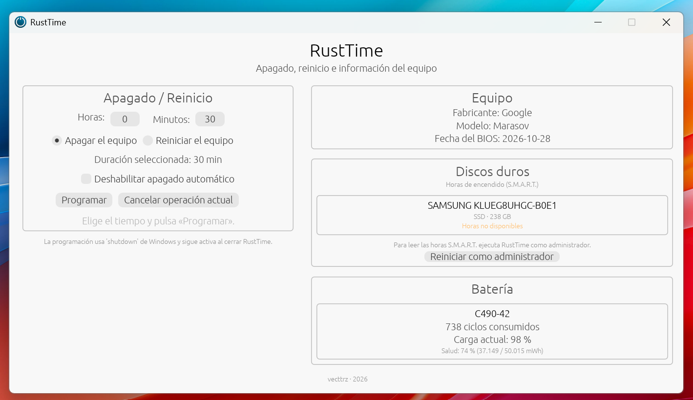

# RustTime v0.1.0

First public release of RustTime.



📄 **Product description and installation instructions:** [docs/PRODUCT.md](https://github.com/vecttrz/RustTime/blob/main/docs/PRODUCT.md) — also attached to this release.

## Quick installation

**Installer (recommended):** download `RustTime-v0.1.0-setup.exe`, run it, accept the User Account Control prompt if it appears, and follow the wizard. RustTime will be available in the Start menu and, if selected, on the desktop.

**Portable:** download `RustTime-v0.1.0-portable.zip`, extract the files, and run `RustTime.exe`. No installation is required.

To uninstall, use *Add or remove programs* or run `unins000.exe` from the installation folder.

## What's new

- Schedule a Windows **shutdown** or **restart** by hours and minutes.
- Cancel the pending operation and a "disable automatic shutdown" mode.
- Computer information: manufacturer, model, and BIOS/motherboard date.
- Disk information: type, capacity, and **total power-on hours** (S.M.A.R.T., requires administrator).
- Battery information: **cycles**, **current charge**, and **health**.
- Horizontal, centered interface with dynamic height and a non-maximizable window.
- **Automatic language:** Spanish when Windows is set to Spanish; English otherwise.
- Application icon, development credits, and data refresh every 5 minutes.

## Release artifacts

| File | Description |
| --- | --- |
| `RustTime-v0.1.0-setup.exe` | Inno Setup installer (shortcuts and uninstaller). |
| `RustTime-v0.1.0-portable.zip` | Portable version: contains `RustTime.exe`, README, LICENSE, and CHANGELOG. |
| `RustTime-v0.1.0-checksums.txt` | SHA-256 hashes of the two files above. |

## Verification

```powershell
Get-FileHash .\RustTime-v0.1.0-setup.exe -Algorithm SHA256
Get-FileHash .\RustTime-v0.1.0-portable.zip -Algorithm SHA256
```

## Requirements

Windows 10 or 11. To read disk S.M.A.R.T. hours, run the application as administrator.

---

Development: **vecttrz** · 2026 · MIT License.
